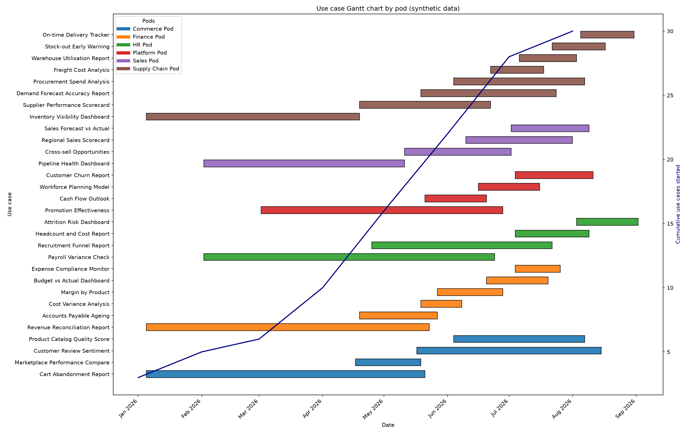

# Roadmap Engine (prototype)

A small Python engine that decides **what to build first** and **when each pod can do it**.

- **Ranks use cases by NPV** (three years of discounted business value minus upfront cost). Use cases that cost nothing go first. "Exception" use cases can override the order.
- **Re-ranks as it goes.** When a use case is picked, its data sources count as enabled, so every other use case that shares those sources gets cheaper, and its NPV is recalculated before the next pick.
- **Schedules pods.** Each pod runs a limited number of activities at once (`max_activity`). Each activity takes a number of days. A heap frees a slot when an activity ends and starts the next one.
- **Draws Gantt charts** (use case level and data source level).

> This is a prototype on **synthetic data**. Everything here belongs to a fictional company,
> "Larkspur Synthetic Group". No real organisation, product, system or person is used.



## Quick start

```bash
pip install -e ".[dev]"          # python 3.10+, pandas 2 or 3
pytest -q                        # 25 tests, including a golden file regression test
python demo/make_gantt.py        # runs the engine on data/synthetic and writes output/
roadmap-run                      # same engine, workbook only (see --help)
```

Use it as a library:

```python
from roadmap_engine import load_config, load_input, run_roadmap

result = run_roadmap(load_config("data/synthetic/configuration_sheet.xlsx"),
                     load_input("data/synthetic/input_data.xlsx"))
result.use_cases_with_sources[["Priority", "use_case_title", "initial_NPV", "NPV"]]
result.df_schedule.head()        # one row per scheduled activity: pod, workstream, start, end
```

## Tools for an agent

`roadmap_engine.tools` has plain functions that return JSON friendly values. An LLM agent should
call them instead of doing arithmetic itself.

```python
from roadmap_engine import tools

tools.calculate_npv([100, 200, 300], costs=50, rate=0.10)
# {"npv": 431.59..., "discounted_values": [90.9, 165.3, 225.4], "costs": 50.0, "rate": 0.1}

state = tools.RoadmapState.from_result(config, result)
tools.check_capacity(state, pod="Finance Pod", effort_days=30, earliest_start="2026-03-01")
# {"pod": "Finance Pod", "max_activity": 4, "fits_on_requested_start": False,
#  "proposed_start": "...", "proposed_end": "...", "wait_days": ..., ...}

tools.rank_use_cases(config, data)   # [{"priority": 1, "use_case_title": ..., "npv": ..., "cost": ...}, ...]
```

## Input data

Two workbooks (the synthetic ones are in `data/synthetic/`, built by `scripts/generate_synthetic_data.py`):

| Workbook | Sheet | Columns |
|---|---|---|
| `configuration_sheet.xlsx` | `config` | `variable`, `value` (discount rate, default days, start date) |
| | `start_date` | `pod_name`, `start_date`, `max_activity` |
| | `exception_use_cases` | `use_case_id` |
| `input_data.xlsx` | `use_cases` | `use_case_id`, `use_case_title`, `business_value_y1..y3`, `status`, `pod_name` |
| | `projects` | `use_case_id`, `project_id`, `use_case_title`, `project_title` |
| | `data_sources` | `data_source_id`, `data_source_title`, `cost`, `data_source_status`, `source`, `domain`, `brand` |
| | `project_sources` | `use_case_id`, `project_id`, `data_source_id`, titles, `source_status`, `actual_start_date`, `actual_end_date` |

The output workbook has five sheets: `df_schedule`, `project_sources`, `use_cases_with_sources`,
`projects`, `data_sources`. How the numbers are produced is explained in [docs/logic.md](docs/logic.md).

## Repository layout

```
src/roadmap_engine/
  config.py       Config dataclass and workbook loader
  io.py           read inputs, write outputs
  npv.py          NPV and cost helpers
  prioritize.py   dynamic NPV ranking loop
  durations.py    expected days when sources, domains or use cases are already enabled
  scheduler.py    pod scheduler (heapq)
  engine.py       run_roadmap(): the whole pipeline
  tools.py        agent facing functions
demo/make_gantt.py          charts (headless, nothing opens on screen)
scripts/generate_synthetic_data.py   seeded data generator
scripts/check_scrub.py      pre-publish checks
tests/                      unit tests, schedule properties, golden regression test
```

## How it is tested

`tests/golden/golden_output.xlsx` was produced by running the original single script version of
this prototype on the synthetic data. `tests/test_golden.py` checks that the packaged engine
reproduces all five output sheets value by value. Other tests check that no pod ever exceeds its
capacity, that exceptions and zero cost use cases are ranked first, and that `check_capacity`
never proposes an overbooked slot.

## Limits (it is a prototype)

- Days are calendar days. There are no weekends, holidays or part time capacity.
- The ranking is greedy (best next pick), not a global optimum.
- Activities only depend on each other through "already enabled" shortening. There are no explicit
  predecessor links.
- Durations are fixed at the moment an activity is scheduled.
- A use case whose sources are all already enabled has zero effort and no rows in `df_schedule`.

## License

[PolyForm Noncommercial 1.0.0](LICENSE). Copyright (c) 2026 Jaishri Rai.
You may use, modify and share the code for noncommercial purposes. Commercial use needs
the author's permission.
